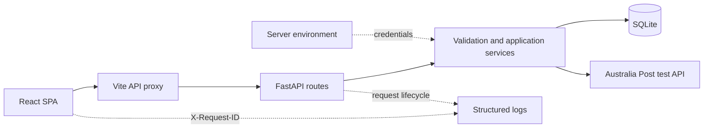

# Order Track Application

面向澳大利亚订单履约场景的全栈订单管理系统。系统按订单独立展示客户、商品行、GST、Shipment 和物流信息，使用 AUD，并连接 Australia Post 测试 API 查询邮费服务和运单状态。

## 功能

- **订单管理**：搜索、筛选、创建和更新订单；按业务状态流转。
- **商品目录**：按 SKU 搜索、查看、添加和编辑商品信息、含 GST 价格、重量及尺寸；被订单行引用的商品不可删除。
- **承运商管理**：维护承运商资料和启用状态；仍被 Shipment 引用的承运商不可删除，可停用以阻止新 Shipment 使用。
- **Shipment 管理**：将订单行分配给 Shipment，维护 Tracking Number 和历史费用。
- **Shipping Planner**：为 Shipment 选择订单行、计算商品重量、输入包裹信息、查询报价并应用所选运费。
- **报价账号档案**：按 Shipment 选择服务端预先配置的报价账号；历史 Shipment 保存账号档案引用和掩码账号。
- **Tracking**：查询运单状态、更新时间和事件；无法查询时明确显示错误或不可用状态。
- **API Testing**：查看报价账号关联的 Australia Post 邮寄产品、合同有效期及可用功能。
- **请求日志**：记录前后端请求生命周期，并使用 Request ID 关联应用请求与承运商请求。

## 技术栈

| 区域 | 技术 |
| --- | --- |
| 前端 | React 18、TypeScript、Vite、MUI、React Router |
| 后端 | Python、FastAPI、Pydantic、SQLAlchemy、HTTPX |
| 数据库 | SQLite；SQLAlchemy ORM；JSON 种子数据 |
| 测试 | pytest、Playwright、TypeScript 编译检查 |

## 架构



前端通过统一 API 客户端请求 `/api`；Vite 在本地开发时将请求代理至 FastAPI。后端路由进行输入校验并调用应用服务。数据库读写、金额计算、订单状态和 Shipment 关联由后端负责。承运商凭据只从服务端环境配置读取。

## 项目结构

```text
backend/
  app/
    routes/             FastAPI 路由
    database.py         SQLAlchemy 模型、数据库初始化与种子导入
    db_service.py       订单、商品和 Shipment 业务逻辑
    shipping_service.py Australia Post 报价适配器
    tracking_service.py 承运商 Tracking 适配器
    logging_service.py  结构化日志与敏感字段遮盖
  tests/                后端 API 与服务测试
scripts/
  tnt_smoke.py          与应用分离的 TNT 请求探测工具
frontend/
  src/
    features/orders/    订单相关组件
    features/api-testing/账号产品查询页面
    features/shipping/  报价账号选择与邮寄产品展示组件
    shared/             API 客户端、类型、格式化和公共组件
    main.tsx            应用路由与页面组合
  e2e/                  Playwright 端到端测试
data/
  orders.json           合成订单种子数据
  products.json         商品种子数据
  source/               SKU 查询结果的本地快照
```

## 数据来源与输入结构

- `data/orders.json` 包含两笔基础订单以及各自独立的订单行和 Shipment。应用逐单读取与计算，不会把不同客户的订单合并。
- `data/products.json` 是 SKU 商品数据的本地 JSON 快照，保存 SKU、名称、描述、含 GST 的 RRP、重量和尺寸。`data/source/sku-query-result.json` 保存用于整理该快照的查询结果；运行时不连接 SQL-like 查询页面，也不把它当作外部 API。
- 商品图片区域使用通用占位图，不代表真实商品图片。
- 新增测试订单时，订单应提供订单编号、日期、状态、客户、配送地址、订单行和 Shipment。订单行以 SKU 匹配商品目录，并包含正整数数量；已分配的历史订单行通过 `tracking_group` 对应 Shipment。商品记录以 SKU 为主键，金额以 AUD 字符串保存，重量与尺寸应带明确单位。

最小订单输入示例：

```json
{
  "currency": "AUD",
  "orders": [
    {
      "order_id": "PO-EXAMPLE-0001",
      "order_date": "2026-01-15",
      "status": "Draft",
      "company_name": "Example Company",
      "customer": {
        "name": "Example Customer",
        "phone": "0400000000",
        "email": "customer@example.com"
      },
      "shipping_address": {
        "street": "1 Example Street",
        "suburb": "Sydney",
        "state": "NSW",
        "postcode": "2000",
        "country": "Australia"
      },
      "line_items": [{ "sku": "AURPUR10", "quantity": 1, "tracking_group": null }],
      "shipments": []
    }
  ]
}
```

以上仅展示订单 JSON 的主要字段；完整字段和验证规则以种子数据、FastAPI schema 及 OpenAPI 文档为准。

## 业务规则

- 商品目录 RRP 是新增订单行的默认含税价格；创建或编辑订单时可以为具体订单行手动覆盖。服务端校验正数金额并将 RRP 保存为订单行价格快照，后续商品目录价格变更不会改写已保存订单。
- RRP 含 GST；新增订单行默认 GST 税率为 10%，并可按订单行编辑。服务端以含税 RRP 行总额计算 GST，按 HALF_UP 舍入至分，再用差额得到未税行小计；展示用未税单价单独舍入，不参与行小计计算。金额以整数分保存，订单总额由未税小计、各行 GST 和已保存 Shipment 运费组成。
- Order Lines 中的 Assigned Tracking 只读显示对应 Shipment 的 Tracking Number；其值从 Shipment 关联派生，不在订单行中重复存储。
- 新增订单行默认不分配 Shipment；每条订单行最多关联一个 Shipment。创建和更新时校验 SKU、数量及 Shipment 与订单的归属关系。
- 状态依次为 `Draft → Confirmed → In Transit → Completed`。`Confirmed` 和 `In Transit` 可退回 `Draft`；`Completed` 为终态。进入 `In Transit` 前至少需要一个非空 Tracking Number。
- 报价只在用户选择服务并成功应用后计入 Shipment 运费。修改报价输入会使当前报价选择失效；服务端校验报价有效期及其订单/Shipment 关联。

金额计算示例（RRP A$19.99、数量 100、GST 10%）：含税行总额为 A$1,999.00；行 GST 为 `ROUND_HALF_UP(1,999.00 × 10 / 110, 2) = A$181.73`；未税行小计为 A$1,817.27。界面显示的未税单价 A$18.17 仅供阅读，避免先舍入单价再乘数量造成累计误差。

## 数据与计算假设

- 输入数据中给出的报价起点为 Ryde, NSW 2111；本地测试时，当前 Australia Post 配置对该起点返回必填属性错误，而 Richmond, VIC 3121 可正常报价。因此 Shipping Rates 和 Shipping Planner 默认使用 Richmond。此默认值记录的是当前测试结果，不代表所有 Australia Post 账号都必须使用该地点；起点仍由请求表单传入，账号合同与上游校验可能限制可用地点。
- 基础订单中已有的 Shipment 运费是本地保存的历史金额；打开 Tracking 或刷新物流信息不会重新计算或覆盖已保存运费。新 Shipment 运费来自成功返回并应用的 Australia Post 服务报价。若接口无可用服务、报价失败或承运商尚未集成，则不会生成虚构费用。
- 运单号、物流事件和服务价格以已保存种子数据或上游 API 返回为准。API 不可用、未查询或未实现时，页面显示相应状态，不补造实时结果。

## 承运商集成

Carrier 是业务界面中的承运商选项，`integration_type` 决定后端实际调用哪个 API 适配器。目前 Australia Post 和 StarTrack 两个选项的 `integration_type` 都是 `AUSTRALIA_POST`，所以它们的报价和 Tracking 都经由同一套 Australia Post API 适配器处理；项目没有单独的 StarTrack API 适配器。`rate_capability` 和 `tracking_capability` 是承运商描述字段，不作为后端请求权限开关；是否能请求由有效承运商、适配器实现及上游账号授权共同决定。

报价请求使用用户选定的 Pricing Account 档案，该档案决定报价时使用的账号和合同服务范围。Tracking 页面目前不提供账号选择，使用服务端的 `AUSTRALIA_POST_TRACKING_ACCOUNT_NUMBER`；未配置时依次回退到旧共享账号和报价账号。因此，报价账号与 Tracking 账号可以分别配置，但当前代码并不会因为选择 StarTrack 就自动换到另一套 API 或账号。

- 报价使用 Australia Post 测试端点 `/shipping/v1/prices/shipments`。
- Australia Post 根据请求中的账号、起点、目的地和包裹信息返回可用邮寄服务及价格；应用展示上游报价，不使用本地固定费率公式生成报价。用户选择并应用服务后，系统保存 Shipment 的运费、邮寄产品 ID 和报价来源。
- Tracking 请求由后端代理；前端不直接持有 API key、密码或账号号。
- 测试环境返回结果取决于账号授权、测试数据、网络和上游服务。测试报价不代表承运合同价格。
- **TNT 尚未集成到订单或 API Testing 页面**；当前应用不会将 TNT 请求转发给 Australia Post，也不会伪造 TNT 报价或物流状态。基础数据中的 TNT Shipment Fee 为 A$0.00，Tracking 查询会返回未实现/不可用状态。`scripts/tnt_smoke.py` 是独立的请求探测工具，不构成应用集成。后续 TNT 适配器计划在 `feature/tnt-api` 分支开发。

## 环境配置

将项目根目录 `.env.example` 复制为 `.env`，只在本地或部署平台的服务端密钥配置中填写实际值。核心订单和商品功能无需承运商凭据即可启动。

| 变量 | 用途 |
| --- | --- |
| `DATABASE_URL` | 数据库连接；留空时使用 `data/oms.db` |
| `AUSTRALIA_POST_API_KEY` | Australia Post API 用户名 / Key |
| `AUSTRALIA_POST_API_PASSWORD` | Australia Post API 密码 |
| `AUSTRALIA_POST_PRICING_ACCOUNT_NUMBER` | 报价账号；未设置时回退至旧共享账号变量 |
| `AUSTRALIA_POST_PRICING_ACCOUNT_LABEL` | 单账号兼容配置的界面显示名称；默认 `eParcel and International` |
| `AUSTRALIA_POST_ACCOUNT_PROFILES_JSON` | 报价账号档案数组；每个档案引用账号号码及凭据对应的服务端环境变量 |
| `AUSTRALIA_POST_ACCOUNT_SAME_DAY` | Same Day Services 报价账号；仅保存在服务端 `.env` |
| `AUSTRALIA_POST_ACCOUNT_ST_PREMIUM_EXPRESS` | ST Premium and ST Express 报价账号；仅保存在服务端 `.env` |
| `AUSTRALIA_POST_ACCOUNT_ON_DEMAND` | On Demand (OD) 报价账号；仅保存在服务端 `.env` |
| `AUSTRALIA_POST_TRACKING_ACCOUNT_NUMBER` | 可选 Tracking 账号；未设置时依次回退到旧共享账号和报价账号 |
| `AUSTRALIA_POST_ACCOUNT_NUMBER` | 兼容旧本地配置的共享账号变量 |
| `AUSTRALIA_POST_BASE_URL` | API 根地址；默认使用 Australia Post 测试环境 |

账号号码在项目根目录的本地 `.env` 配置；该文件被 Git 忽略。`.env.example` 只列出变量名和档案结构，不包含账号号码、API Key 或密码。多个报价账号按固定 ID、显示名称和环境变量引用配置，例如：

```dotenv
AUSTRALIA_POST_ACCOUNT_PROFILES_JSON='[{"id":"eparcel-international","label":"eParcel and International","account_number_env":"AUSTRALIA_POST_PRICING_ACCOUNT_NUMBER","default_for_pricing":true},{"id":"same-day-services","label":"Same Day Services","account_number_env":"AUSTRALIA_POST_ACCOUNT_SAME_DAY"},{"id":"st-premium-express","label":"ST Premium and ST Express","account_number_env":"AUSTRALIA_POST_ACCOUNT_ST_PREMIUM_EXPRESS"},{"id":"on-demand","label":"On Demand (OD)","account_number_env":"AUSTRALIA_POST_ACCOUNT_ON_DEMAND"}]'
```

`id` 必须唯一且使用小写字母、数字和连字符；`label` 必须唯一并作为界面名称；`account_number_env` 指定账号号变量，账号号按 1–20 位数字字符串校验并保留前导零，不得转换为整数；只能有一个 `default_for_pricing: true`。每个档案也可通过 `api_key_env`、`api_password_env` 和 `base_url_env` 指向单独的服务端环境变量；省略时使用共享的 Australia Post API 凭据和 API 根地址。浏览器只接收档案 ID、名称、环境和掩码账号。Tracking 仍使用独立的 `AUSTRALIA_POST_TRACKING_ACCOUNT_NUMBER` 配置。

API Testing 下的 Account Products 和 Shipping Rates 页面都支持选择已配置档案；Shipping Planner 也按 Shipment 选择报价账号。Get Rates 查询所选账号对当前包裹和路线可用的服务，Apply 后 Shipment 保存账号档案、返回的邮寄产品 ID 及运费快照。

`.env.example` 中的 `TNT_*` 变量仅供 `scripts/tnt_smoke.py` 的显式接口试验使用；当前应用 API 和页面尚未集成 TNT。

## 本地运行

需要 Python 3.10+ 和 Node.js 18+。

### 启动后端

```bash
cd backend
python3 -m venv .venv
source .venv/bin/activate
pip install -r requirements.txt
uvicorn app.main:app --reload --host 127.0.0.1 --port 8003
```

这里只安装 `requirements.txt` 中的运行依赖即可启动服务。`requirements-dev.txt` 用于运行后端测试；它会包含运行依赖，并额外安装 `pytest`。

### 启动前端

```bash
cd frontend
npm ci
npm run dev -- --host 127.0.0.1 --port 5176
```

前端地址：<http://127.0.0.1:5176/>

后端健康检查：<http://127.0.0.1:8003/api/health>

本地 OpenAPI 文档：<http://127.0.0.1:8003/docs>

首次启动会创建 SQLite 表并幂等导入 `data/` 中的种子数据。`create_all` 和当前的 SQLite 兼容迁移只覆盖项目已有场景，不替代通用数据库迁移工具。

## API 概览

| 资源 | 主要路由 |
| --- | --- |
| Products | `GET/POST /api/products`、`GET/PATCH/DELETE /api/products/{sku}` |
| Orders | `GET/POST /api/orders`、`GET/PATCH /api/orders/{order_id}`、`PATCH /api/orders/{order_id}/status` |
| Shipments | `POST /api/orders/{order_id}/shipments`、`PATCH/DELETE /api/shipments/{shipment_id}` |
| Carriers | `GET/POST /api/carriers`、`GET/PATCH/DELETE /api/carriers/{carrier_id}` |
| Shipping | `GET /api/shipping/accounts`、`GET /api/shipping/accounts/{profile_id}/products`、`POST /api/shipping/rates`、`POST /api/shipping/orders/{order_no}/quotes/preview`、`POST /api/shipping/orders/{order_no}/shipments/save`、`POST /api/shipping/orders/{order_no}/quotes/apply`、`POST /api/shipping/shipments/{shipment_id}/apply-rate` |
| Tracking | `POST /api/orders/tracking`、`GET /api/orders/{order_id}/tracking?refresh=false` |

请求和响应字段以 FastAPI OpenAPI 定义及 `backend/app/models.py` 为准。
旧路径 `GET /api/shipping/account-products` 暂时保留，供现有本地调用兼容；新页面使用带档案 ID 的路径。

## 测试与构建

```bash
# 后端
cd backend
pip install -r requirements-dev.txt
pytest -q

# 前端类型检查、构建和端到端测试
cd ../frontend
npx tsc --noEmit
npm run build
npx playwright install chromium  # 首次运行时安装浏览器
npm run test:e2e
```

端到端测试使用固定 API fixtures，不会请求真实承运商服务。真实 Australia Post 请求需要配置有效的服务端凭据，并受测试账号权限限制。

## 日志

后端以 JSON Lines 格式输出日志到终端及 `backend/logs/api-calls.log`，单个日志文件上限 5 MiB，保留 3 份轮转文件。前端请求事件写入浏览器 Console。`X-Request-ID` 用于关联浏览器请求、FastAPI 生命周期事件和承运商上游调用。

日志不记录认证头、请求/响应正文或完整 Tracking Number；Tracking Number 会遮盖并最多保留末四位。报价日志目前包含起运和目的地邮编，因此日志文件应限制访问并按需要设置保留期限。日志用于运行排查，不是审计系统。

## 安全说明

- 承运商凭据只应存放在服务端环境变量或部署平台的密钥配置中。
- 本仓库订单样例由项目维护者确认为合成数据。不要将真实个人资料、业务订单、运单号或生产凭据加入种子文件、截图和日志。
- 部署环境应配置 HTTPS、适当的网络访问策略、密钥管理、日志数据最小化、数据库迁移与备份，并限制 OpenAPI 文档的访问范围。

## 当前限制

- 待应用报价仅保存在单个后端进程内，15 分钟后过期；服务重启或多实例部署不会共享报价缓存。Account Products 响应也会在单进程内短暂缓存。
- 当前数据库为 SQLite，没有完整的通用迁移与灾备方案。
- Australia Post 连接至测试环境，实际服务权限和报价结果依账号及上游状态而异。
- 本地 Shipment 记录不会自动创建承运商运单、面单或取件任务。

## 许可证

当前仓库尚未包含 `LICENSE` 文件。公开仓库本身不授予代码复制、修改或再分发的许可；添加许可证前，请勿假设本项目可按特定开源许可证使用。
